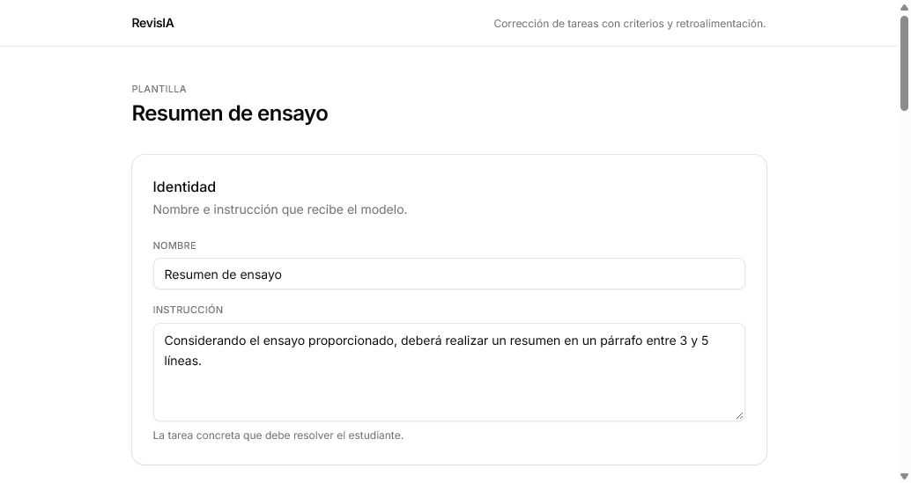

# RevisIA

Aplicación web para corregir entregas académicas (ensayos, resúmenes, informes) contra una
rúbrica, usando un modelo de lenguaje para calificar por criterio y generar
retroalimentación automática.

Proyecto de la asignatura *Tecnologías Avanzadas Empresariales apoyadas por IA* —
Universidad Técnica de Manabí.



## Qué hace

- **Ingesta desde Moodle**: sube un PDF individual o el ZIP completo de una tarea. Se
  descomprime de forma segura (bloquea *zip-slip* y bombas de descompresión), se filtran
  PDF/DOCX y se deduplican por `sha256`.
- **Identificación de estudiantes**: importa el padrón por CSV, parsea los nombres de
  archivo con los patrones de Moodle (`Nombre_Apellido_12345.pdf`) y extrae metadatos
  (nombre, integrantes, título) del encabezado del documento con el LLM. Los PDFs sin capa
  de texto caen a un camino de visión.
- **Trabajos grupales**: varias entregas de un mismo grupo se unifican en una sola
  entrega, con una sola calificación.
- **Contexto académico completo**: actividad con descripción, objetivos, instrucciones,
  documento fuente y contextos adicionales; rúbrica con criterios, niveles y puntajes.
- **Calificación por rúbrica**: el modelo devuelve un puntaje por criterio y
  retroalimentación corta; el total se recalcula en código y los puntajes se acotan a los
  límites de cada criterio.
- **Export a Excel**: `.xlsx` con estudiante, título, calificación por criterio y total.
  Las entregas sin calificar aparecen igual, con su estado.
- **Administración**: un administrador gestiona docentes, asignaturas y API keys de los
  proveedores de IA. Las claves se guardan cifradas y nunca vuelven al cliente.

## Stack

| Capa | Tecnología |
|---|---|
| UI | SvelteKit 3 + Svelte 5 (runes) + Tailwind 4 + shadcn-svelte |
| Base de datos | Postgres (Neon) + Drizzle ORM |
| Archivos | Cloudflare R2 (bucket privado, URLs prefirmadas) |
| Autenticación | Better Auth (email/password + roles `admin` / `docente`) |
| IA | OpenAI-compatible, Anthropic o Google |
| Extracción | `unpdf` (PDF), `mammoth` (DOCX), `yauzl` (ZIP) |
| Excel | `exceljs` |
| Tests | Vitest + PGlite en memoria |

## Estructura

```
src/
  routes/(app)/        actividades, rúbricas, revisión, asignaturas
  routes/admin/        docentes, asignaturas, API keys, ajustes
  routes/(app)/api/    endpoints de ingesta, matching, calificación y export
  lib/domain/          prompt, normalización de respuesta, export, roster
  lib/server/          db, auth, R2, cifrado, repositorios, extracción
drizzle/               migraciones SQL generadas
tests/                 30 archivos de test (dominio, repositorios, servidor)
docs/entrega/          documento del curso y diagramas BPMN
odd/tasks/             notas de desarrollo por funcionalidad
```

## Requisitos

- Node 20+
- pnpm 9+ (`engine-strict` está activo en `.npmrc`)
- Una base Postgres (Neon o local)
- Un bucket S3-compatible (Cloudflare R2)
- Una API key del proveedor de IA

## Puesta en marcha

```bash
pnpm install
cp .env.example .env      # en Windows: copy .env.example .env
# completar las variables del .env
pnpm db:migrate
pnpm db:seed              # crea el admin inicial con SEED_ADMIN_*
pnpm dev
```

`.env.example` es la fuente de verdad de las variables; cada bloque está documentado
ahí. Las mínimas para arrancar son `DATABASE_URL`, `BETTER_AUTH_SECRET`,
`AI_API_KEY` y las cuatro de R2.

> Si tu red bloquea el puerto 5432 saliente, poné `DATABASE_TRANSPORT=websocket` para
> ir por WSS/443 con `@neondatabase/serverless`.

## Scripts

| Comando | Qué hace |
|---|---|
| `pnpm dev` | Servidor de desarrollo |
| `pnpm build` | Build de producción |
| `pnpm check` | `svelte-check` sobre todo el proyecto |
| `pnpm test` | Vitest (una pasada) |
| `pnpm db:generate` | Genera una migración desde el schema Drizzle |
| `pnpm db:migrate` | Aplica las migraciones pendientes |
| `pnpm db:studio` | Drizzle Studio |
| `pnpm db:seed` | Crea el admin y datos de ejemplo |
| `pnpm fixtures:f2` | Regenera `entregas-prueba/` (padrón + ZIP de Moodle de prueba) |

## Flujo de uso

1. El administrador entra en `/admin`, crea los docentes y las asignaturas, y carga la API
   key del proveedor de IA.
2. El docente crea una actividad: contexto, documento fuente y rúbrica.
3. Importa el padrón de la materia (CSV) y sube las entregas (PDF o ZIP de Moodle).
4. Revisa la tabla de *matching* — cada archivo se puede vincular o desvincular a mano.
5. Califica y exporta el `.xlsx` de la actividad.

`entregas-prueba/` trae un juego de entregas sintéticas con casos borde documentados
(nombre invertido, sin nombre en el encabezado, grupo de tres integrantes, DOCX, alumno
fuera del padrón) para probar todo el flujo sin datos reales.

## Seguridad

- Las API keys de los docentes se cifran con AES-256-GCM (`API_KEY_ENCRYPTION_KEY`) y solo
  se exponen los últimos cuatro caracteres.
- El bucket de archivos es privado: cliente y servidor usan URLs prefirmadas.
- Los archivos nunca pasan por el servidor de aplicación en la subida; van directo a R2.
- `.env*` y `.neon` están fuera del repositorio. **No subas credenciales**: si una clave
  llegó a un archivo versionado, rotala.

## Tests

```bash
pnpm test
```

30 archivos bajo `tests/`, con Vitest y PGlite en memoria para los repositorios. Cubren
render y presupuesto de tokens del prompt, extracción de archivos, ZIP malicioso, parseo
de nombres de Moodle, matching, export de Excel, cifrado de claves y guardas de ruta.

## Documentación

- `docs/entrega/Documento-RevisIA.md` — documento completo del proyecto (introducción,
  objetivos, arquitectura, procesos, tecnologías, codificación, manual de usuario).
- `docs/entrega/bpm/` — diagramas BPMN de los tres procesos.
- `ROADMAP.md` — estado frente a la rúbrica de la asignatura y fases pendientes.
- `Especificaciones.md` — consigna original del trabajo.

## Licencia

Sin licencia definida. El código se publica con fines académicos; si querés reutilizarlo,
abrí un issue para conversarlo.
