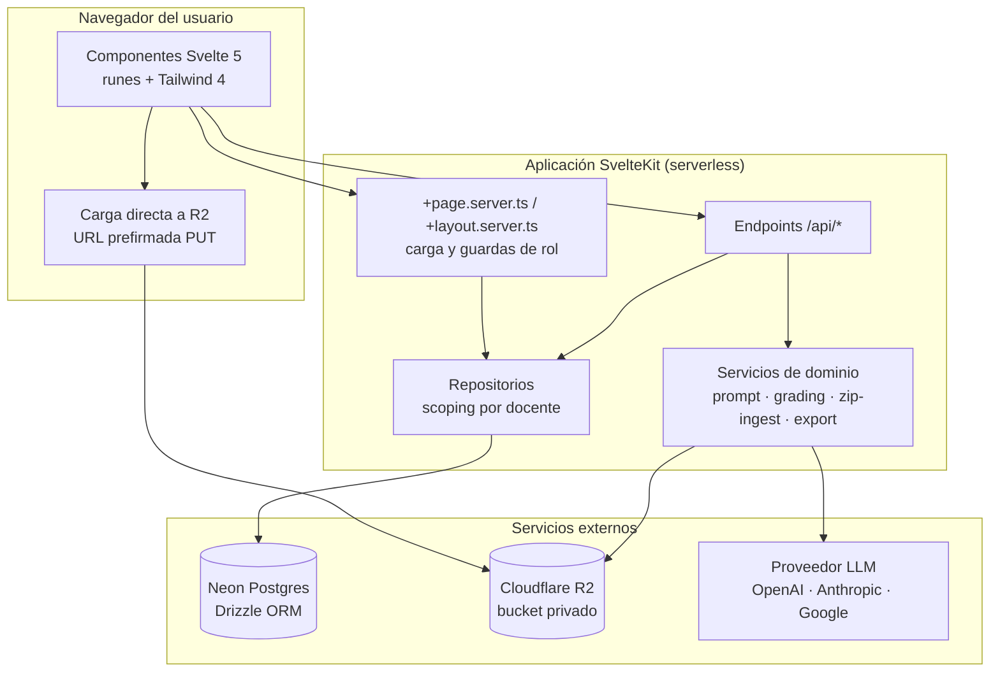
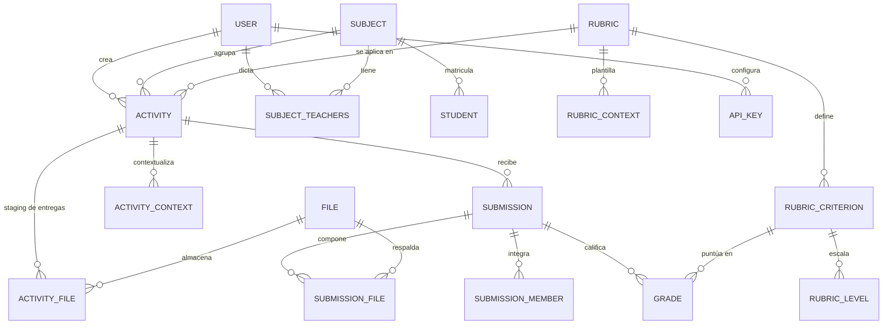
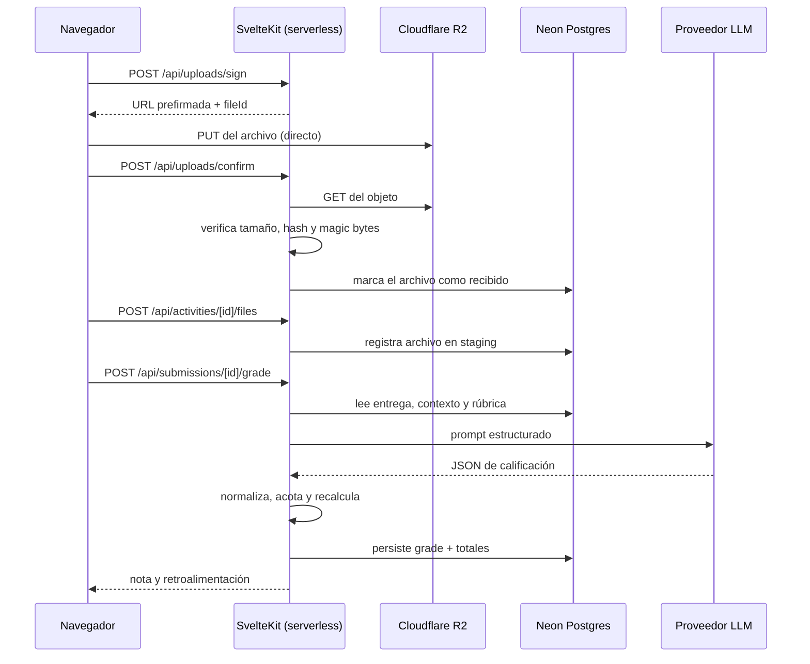
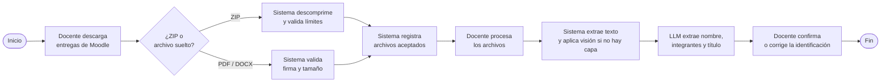
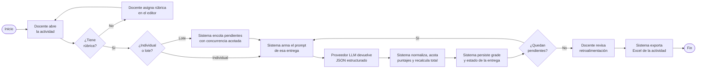
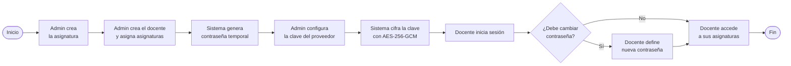

# RevisIA — Sistema web de evaluación automática de resúmenes con modelos de lenguaje y rúbricas dinámicas

| | |
|---|---|
| **Universidad** | Universidad Técnica de Manabí |
| **Facultad** | Facultad de Ciencias Informáticas |
| **Carrera** | Ingeniería en Desarrollo de Software |
| **Asignatura** | Tecnologías Avanzadas Empresariales apoyadas por IA |
| **Docente** | Ing. Javier Cuzco Torres, PhD |
| **Estudiante** | Axel Mayckel Lajones Gonzalez |
| **Período académico** | 2026 |
| **Tema** | Uso de modelo entrenado para la evaluación de resúmenes utilizando un texto base de alguna temática y rúbrica de evaluación |

---

## 1. Introducción

### 1.1 Contexto

La evaluación de resúmenes y ensayos es una de las tareas con mayor carga operativa
para el docente universitario. Calificar cuarenta entregas contra cinco criterios
implica doscientas decisiones de valoración, cada una con su justificación escrita,
y el resultado debe ser consistente entre estudiantes para que la calificación sea
defendible. Esa consistencia es precisamente lo que se pierde cuando la revisión se
hace en serie, al final de una jornada, con el criterio agotado.

Los modelos generativos de lenguaje ofrecen una respuesta razonable a ese problema:
un modelo preentrenado ya comprende lenguaje natural, por lo que no requiere
fine-tuning para evaluar un texto contra criterios explícitos. Lo que sí requiere es
que el criterio esté formulado sin ambigüedad, que el modelo reciba el material de
referencia correcto y que la salida esté restringida a una estructura verificable.

### 1.2 Problema

El flujo real de un docente con entregas descargadas de Moodle tiene cuatro puntos
de fricción que las herramientas genéricas no resuelven:

1. **La importación.** Moodle entrega un ZIP con nombres de archivo inconsistentes
   (`Nombre_Apellido_12345.pdf`, con acentos, con prefijos de comisión).
2. **La identificación.** Saber qué archivo pertenece a qué estudiante del padrón,
   y en los trabajos grupales quiénes son los integrantes.
3. **El contexto.** La evaluación no depende solo del resumen: depende del texto
   base, de la consigna, de los objetivos y de la rúbrica concreta de esa actividad.
4. **El registro.** Una calificación sin trazabilidad por criterio no sirve para
   reclamaciones ni para informes de asignatura.

### 1.3 Solución propuesta

**RevisIA** es una aplicación web que recibe el contexto académico de una actividad
(texto base, consigna, objetivos, instrucciones), una rúbrica dinámica con criterios,
descripciones, pesos, puntajes máximos y niveles, y las entregas de los estudiantes
en PDF o en un ZIP descargado de Moodle. El sistema extrae el texto de cada entrega,
construye un prompt estructurado que respeta la rúbrica de esa actividad, consulta un
modelo de lenguaje preentrenado y persiste la calificación por criterio junto con la
retroalimentación. Finalmente exporta el conjunto de notas a Excel.

La decisión de diseño central es que **el modelo no es la fuente de verdad**. El
modelo propone puntajes y retroalimentación; el código valida la estructura de la
respuesta, acota cada puntaje al máximo del criterio, recalcula el total y decide qué
se guarda. Un modelo que alucina un criterio inexistente no puede corromper la nota.

### 1.4 Alcance

La aplicación cubre el flujo completo: administración de docentes y asignaturas,
gestión de contexto académico, ingesta de entregas desde Moodle, identificación de
estudiantes, calificación individual y masiva contra rúbrica, y exportación de
resultados. Queda fuera del alcance la integración directa con la API de Moodle
(la importación es por archivo), el reconocimiento óptico de caracteres formal para
documentos escaneados y la notificación automática de notas al estudiante.

### 1.5 Organización del documento

La sección 2 define los objetivos. La sección 3 describe la arquitectura y el modelo
de datos. La sección 4 modela los procesos de negocio con notación BPMN. La sección 5
justifica las tecnologías. La sección 6 presenta fragmentos representativos del
código. La sección 7 es el manual de usuario. La sección 8 documenta la verificación
ejecutada y la sección 9 declara las limitaciones conocidas.

---

## 2. Objetivos

### 2.1 Objetivo general

Desarrollar una aplicación web que evalúe automáticamente resúmenes y ensayos en
formato PDF contra un texto base y una rúbrica dinámica, utilizando un modelo de
lenguaje preentrenado mediante ingeniería de prompt, y que registre y exporte las
calificaciones por criterio.

### 2.2 Objetivos específicos

| # | Objetivo específico | Criterio de la rúbrica | Evidencia en el sistema |
|---|---|---|---|
| 1 | Importar actividades y entregas descargadas de Moodle en PDF y ZIP | Importación de actividades | `zip-ingest.ts`, `/api/uploads/zip`, `/api/activities/[id]/files` |
| 2 | Identificar automáticamente autor, integrantes, archivo y título de cada entrega y vincularlos al padrón | Identificación de estudiantes | `metadata-extraction.ts`, `roster.ts`, `/api/submissions/[id]/metadata` |
| 3 | Permitir la definición del contexto académico completo de una actividad | Gestión de contexto | `activity`, `activity_context`, `ActivityEditor.svelte` |
| 4 | Calificar una entrega individual y un lote completo con progreso y errores aislados | Evaluación individual y masiva | `/revisar/[id]`, `pool.ts`, `/api/submissions/[id]/grade` |
| 5 | Asignar puntaje por criterio según la rúbrica y exportar los resultados a Excel | Calificación e informes | `normalize.ts`, `grade`, `export-workbook.ts` |
| 6 | Proveer un rol administrador que gestione docentes, asignaturas y claves de API | Gestión de administración | `/admin/*`, `api-key.ts`, `crypto.ts` |

---

## 3. Arquitectura

### 3.1 Vista general

La aplicación sigue una arquitectura **cliente-servidor en capas**, con renderizado
en servidor (SSR) y tres servicios externos: base de datos, almacenamiento de objetos
y proveedor de modelo de lenguaje.



Cada capa tiene una responsabilidad excluyente:

| Capa | Responsabilidad | Ubicación |
|---|---|---|
| Presentación | Render, estado de UI, validación de formularios | `src/routes/**/*.svelte`, `src/lib/components` |
| Carga y guardas | Sesión, rol, datos iniciales de la página | `+layout.server.ts`, `+page.server.ts` |
| API | Contratos HTTP, códigos de estado, validación de entrada | `src/routes/(app)/api/**` |
| Servicios de dominio | Reglas que no pertenecen a la base ni a la vista | `src/lib/server/{grading,prompt,zip-ingest,export-workbook}.ts` |
| Dominio puro | Funciones sin I/O, testeables en aislamiento | `src/lib/domain/*` |
| Persistencia | Consultas tipadas y aislamiento por docente | `src/lib/server/repositories/*` |

La separación entre **dominio puro** y **servicios** es deliberada: la construcción
del prompt, la normalización de la respuesta del modelo, el parseo de nombres de
Moodle y la generación del libro de Excel son funciones sin efectos secundarios, por
lo que se prueban sin red, sin base de datos y sin modelo.

### 3.2 Decisiones arquitectónicas

**a) La calificación ocurre en el servidor.** El endpoint de calificación no recibe
ni el prompt ni la rúbrica: recibe únicamente el identificador de la entrega. El
servidor lee la entrega, el texto extraído, el contexto de la actividad y la
plantilla de rúbrica. Esto elimina la posibilidad de que un cliente construya una
calificación contra una rúbrica inventada.

**b) Los archivos no pasan por el servidor de aplicación.** El navegador solicita una
URL prefirmada, sube el archivo directamente al almacenamiento de objetos y luego
confirma la subida. El servidor descarga el objeto una sola vez, en el paso de
confirmación, para verificar tamaño real y bytes de cabecera. Esto evita el límite de
cuerpo de las funciones serverless y mantiene el bucket privado.

**c) La identidad del archivo es su hash.** El par `(actividad, sha256)` es único:
subir dos veces el mismo PDF no duplica la entrega. La deduplicación también alimenta
la lista de archivos pendientes, que no ofrece dos veces los mismos bytes.

**d) Un trabajo grupal es una sola entrega.** Modelar un grupo como N entregas
costaría N llamadas al modelo por el mismo texto. El modelo de datos usa una fila
`submission` con N filas `submission_member`, de modo que la calificación se paga una
vez y el integrante principal queda marcado con `is_author`.

### 3.3 Modelo de datos

Doce migraciones sobre PostgreSQL, veintidós tablas. Las entidades principales:



| Tabla | Función |
|---|---|
| `user` | Docentes y administradores; `role` y `active` controlan el acceso |
| `subject`, `subject_teachers` | Asignaturas y su asignación muchos-a-muchos con docentes |
| `student` | Padrón de la asignatura, con `match_key` normalizado |
| `rubric`, `rubric_criterion`, `rubric_level`, `rubric_context` | Rúbrica reutilizable con criterios, niveles y bloques de contexto |
| `activity` | Título, descripción, objetivos, instrucciones, documento fuente, rúbrica |
| `activity_context` | Bloques de contexto propios de la actividad (texto base, etc.) |
| `file` | Metadatos del objeto en R2, texto extraído, hash y metadatos del LLM |
| `activity_file` | Archivos en staging, antes de agruparse en entregas |
| `submission` | Una entrega por estudiante o grupo, con estado y totales |
| `submission_file`, `submission_member` | Documentos de la entrega e integrantes |
| `grade` | Puntaje y retroalimentación por criterio, único por entrega y criterio |
| `api_key` | Claves de proveedor cifradas en reposo, globales o por docente |
| `audit_log` | Trazabilidad de acciones administrativas |
| `grading_cache` | Caché de respuestas del modelo por hash de prompt |

### 3.4 Seguridad y aislamiento entre docentes

El sistema es multiinquilino desde la base: **todas** las funciones de repositorio
reciben el identificador del docente y lo aplican en el `WHERE`. No existe una
consulta que devuelva datos de otro docente por identificador directo; un acceso
cruzado devuelve vacío o `null`, nunca el registro ajeno.

- **Sesión.** Better Auth emite cookies `httpOnly`; `hooks.server.ts` resuelve la
  sesión en cada request y la adjunta a `locals`.
- **Guardas.** El layout de la aplicación redirige a `/login` sin sesión y fuerza el
  cambio de contraseña inicial; el layout de administración exige `role = 'admin'`.
- **Contraseñas.** Hash con el algoritmo de Better Auth; el alta de un docente genera
  una contraseña temporal que se muestra una sola vez.
- **Claves de API.** Cifradas con AES-256-GCM (`crypto.ts`) antes de persistir; la
  clave en claro nunca se devuelve al cliente, solo los últimos cuatro caracteres.
- **Archivos.** Bucket privado, acceso por URL firmada con expiración de 15 minutos y
  validación de tipo por *magic bytes*, no por extensión.

### 3.5 Despliegue



El cómputo es sin estado: la sesión vive en cookie y el estado de negocio en la base.
Eso permite escalar horizontalmente y reanudar un lote interrumpido, porque cada
entrega guarda su propio estado (`pending`, `processing`, `graded`, `error`).

---

## 4. Procesos

Los procesos se modelan con **BPMN 2.0**. Los archivos editables se incluyen en
`docs/entrega/bpm/` y se abren con [bpmn.io](https://demo.bpmn.io) o Camunda Modeler;
desde allí se exportan como SVG o PNG para insertarlos en la versión impresa. Las
figuras que siguen son una versión equivalente en Mermaid para lectura directa.

### 4.1 P1 — Ingesta de entregas desde Moodle

**Disparador:** el docente descarga de Moodle el paquete de entregas de una tarea.
**Resultado:** los archivos quedan en staging, con texto extraído y metadatos
propuestos, listos para convertirse en entregas.



**Controles del proceso.** El ZIP es entrada no confiable y se trata como tal:

| Riesgo | Control | Ubicación |
|---|---|---|
| *Zip-slip* (`../../.env`) | Se conserva solo el nombre base; una ruta hostil rechaza el archivo completo | `zip-ingest.ts:128` |
| Bomba de descompresión | Límites de 500 entradas, 25 MB por archivo, 100 MB total y ratio 1:100 | `zip-ingest.ts:34` |
| Suplantación de tipo | Los *magic bytes* deciden, no la extensión | `zip-ingest.ts:358` |
| Entradas cifradas | Se clasifican y se reportan con motivo, sin abortar el resto | `zip-ingest.ts:177` |
| Duplicados | `(actividad, sha256)` es único | `db/schema/grading.ts` |

Cada archivo rechazado se informa con un motivo accionable para el docente
(`"El archivo está cifrado con contraseña"`, `"Solo se aceptan PDF o DOCX"`), de modo
que un paquete de Moodle con un `.exe` no obliga a adivinar qué pasó.

### 4.2 P2 — Calificación por rúbrica, individual y masiva

**Disparador:** la actividad tiene entregas procesadas y una rúbrica asignada.
**Resultado:** una nota por criterio, con retroalimentación, persistida por entrega.



**Reglas del proceso.**

1. Una entrega sin texto extraído no se califica: el sistema informa el motivo en
   lugar de enviar un prompt incompleto.
2. Una actividad sin rúbrica no ofrece calificación; muestra el aviso y el enlace al
   editor.
3. Un fallo en una entrega del lote queda registrado en su fila y no cancela el
   resto.
4. Recalificar reemplaza la nota anterior; no acumula filas duplicadas, porque
   `(entrega, criterio)` es único.

### 4.3 P3 — Administración de docentes, asignaturas y claves

**Disparador:** el administrador incorpora un docente al sistema.
**Resultado:** el docente puede iniciar sesión, ver sus asignaturas y trabajar sin
acceder a datos de otros.



**Controles.** El alta y la desactivación de un docente se auditan en `audit_log`. Al
desactivar una cuenta se revocan sus sesiones activas, de modo que la baja es
efectiva de inmediato y no solo en el siguiente inicio de sesión.

### 4.4 Notación

Los diagramas usan los elementos estándar de BPMN 2.0: evento de inicio y de fin,
tareas de usuario (carril del docente) y de servicio (carril del sistema), y
compuertas exclusivas para las decisiones. La separación entre tarea de usuario y
tarea de servicio hace visible qué paso exige una decisión humana: la confirmación de
la identificación del estudiante y la decisión de calificar nunca son automáticas.

---

## 5. Tecnologías utilizadas

| Tecnología | Versión | Rol en el sistema | Justificación |
|---|---|---|---|
| SvelteKit | 3 | Framework full-stack, SSR y ruteo | Un solo proyecto para vistas y endpoints; las guardas de sesión y rol viven en el servidor |
| Svelte 5 (runes) | 5.57 | Reactividad de la interfaz | Estado explícito (`$state`, `$derived`) sin la indirección de los stores |
| TypeScript | 6.0 | Tipado estático de todo el proyecto | Los contratos entre dominio, servicios y vistas se verifican en compilación |
| Tailwind CSS | 4 | Estilos utilitarios | Consistencia visual sin hojas de estilo paralelas |
| shadcn-svelte | 1.7 | Componentes de interfaz | Componentes accesibles y editables, sin dependencia de un sistema cerrado |
| Drizzle ORM | 0.45 | Acceso a datos tipado y migraciones | El esquema es código; las consultas se validan contra los tipos generados |
| PostgreSQL (Neon) | — | Base de datos relacional | Integridad referencial para notas y criterios; *branching* para entornos |
| Better Auth | 1.7 | Autenticación por correo y contraseña | Sesiones con cookie `httpOnly`, hash de contraseñas y control de roles |
| Cloudflare R2 / Filebase | API S3 | Almacenamiento de PDF, DOCX y ZIP | Bucket privado, URLs prefirmadas y egreso sin costo |
| unpdf | 2.1 | Extracción de texto de PDF | Funciona en entorno serverless, sin binarios del sistema |
| mammoth | 1.13 | Extracción de texto de DOCX | Convierte el documento a texto conservando la estructura |
| yauzl | 3.4 | Lectura de ZIP por entradas | Permite validar el tamaño declarado **antes** de inflar, condición para defenderse de una bomba |
| ExcelJS | 4.4 | Generación de archivos `.xlsx` | Escribe el libro en el servidor con una columna por criterio de la rúbrica |
| Vitest + PGlite | 5.1 / 0.5 | Pruebas automatizadas | Ejecuta PostgreSQL en memoria: los repositorios se prueban contra SQL real |
| OpenAI / Anthropic / Google | — | Modelo de lenguaje | Tres adaptadores con la misma interfaz; el proveedor se cambia por configuración |

**Compatibilidad de proveedores.** El mismo requerimiento estructurado se traduce a
tres formatos: `response_format: json_schema` en OpenAI, llamada a herramienta
forzada en Anthropic y `responseSchema` en Google. El adaptador de OpenAI sirve
además para cualquier servicio compatible (OpenRouter, Groq, Ollama, vLLM) cambiando
`AI_BASE_URL`. Esto evita que la aplicación quede atada a un proveedor.

---

## 6. Codificación

Los fragmentos siguientes son código real del sistema, no ejemplos ilustrativos.

### 6.1 Clasificación segura de entradas de un ZIP

El punto crítico de la ingesta es decidir qué entra **antes** de descomprimir nada.
La función es pura: recibe la cabecera de la entrada y decide.

```ts
// src/lib/server/zip-ingest.ts
export function classifyEntry(
	header: EntryHeader,
	state: ClassificationState,
	limits: ZipLimits = ZIP_LIMITS
): EntryDecision {
	const rawName = header.fileName;

	if (rawName.endsWith('/')) return { action: 'reject', reason: 'directory' };

	const baseName = safeBasename(rawName);
	if (!baseName) return { action: 'reject', reason: 'unsafe-path' };

	if (rawName.replace(/\\/g, '/').startsWith('__MACOSX/') || METADATA_NAMES.has(baseName.toLowerCase())) {
		return { action: 'reject', reason: 'metadata' };
	}

	if (state.seen > limits.maxEntries) return { action: 'reject', reason: 'too-many-entries' };

	// Bit 0 del campo de flags marca una entrada cifrada.
	if ((header.generalPurposeBitFlag & 0x1) !== 0) {
		return { action: 'reject', reason: 'encrypted' };
	}

	const extension = extensionOf(baseName);
	if (!extension) return { action: 'reject', reason: 'unsupported-type' };

	if (header.uncompressedSize > limits.maxEntrySize) {
		return { action: 'reject', reason: 'too-large' };
	}

	if (state.totalAccepted + header.uncompressedSize > limits.maxTotalUncompressed) {
		return { action: 'reject', reason: 'total-too-large' };
	}

	const ratio = header.uncompressedSize / Math.max(header.compressedSize, 1);
	if (header.uncompressedSize >= limits.minRatioCheckSize && ratio > limits.maxCompressionRatio) {
		return { action: 'reject', reason: 'suspicious-ratio' };
	}

	return { action: 'accept', baseName, extension };
}
```

La decisión de usar `yauzl` en modo `lazyEntries` en lugar de una descompresión en
memoria responde al mismo problema: una función de un solo paso ya expandió la bomba
cuando se la puede inspeccionar.

### 6.2 Normalización de nombres para el padrón

Tres fuentes escriben el mismo nombre de tres formas: el padrón dice `"Pérez, Juan"`,
Moodle dice `Perez_Juan_12345.pdf` y el encabezado del documento dice `"Juan Pérez"`.
La clave canónica hace que las tres coincidan sin *fuzzy matching*.

```ts
// src/lib/domain/roster.ts
export function normalizeMatchKey(name: string): string {
	return name
		.normalize('NFD')
		.replace(/[\u0300-\u036f]/g, '')   // quita acentos
		.toLowerCase()
		.replace(/[^a-z0-9]+/g, ' ')
		.trim()
		.split(/\s+/)
		.filter(Boolean)
		.sort()                            // ordena tokens: "Pérez, Juan" == "Juan Pérez"
		.join(' ');
}
```

Ordenar los tokens es lo que hace equivalentes el orden natural y el orden de padrón.
Un nombre genuinamente distinto produce otra clave y simplemente no coincide: el
sistema deja la entrega sin vincular para que el docente decida, en lugar de arriesgar
una vinculación incorrecta.

### 6.3 Criterio renderizado en el prompt

El prompt no describe la rúbrica en prosa: la enumera con el nombre exacto del criterio,
sus puntos máximos, su peso y sus niveles, porque la normalización posterior empareja
por ese nombre.

```ts
// src/lib/domain/prompt.ts
function renderCriterion(c: Template['criteria'][number], position: number): string {
	const description = c.description?.trim() ? ` (${c.description.trim()})` : '';
	const weight = c.weight && c.weight !== 1 ? ` | Peso: ${c.weight}` : '';
	const base = `Criterio ${position}: ${c.name}${description} | Puntos máximos: ${c.maxPoints}${weight}`;
	if (!c.levels || c.levels.length === 0) return base;
	const levels = [...c.levels]
		.sort((a, b) => a.points - b.points)
		.map((l) => `${l.label}=${l.points}${l.description ? ` (${l.description})` : ''}`)
		.join(', ');
	return `${base} | Niveles: ${levels}`;
}
```

Cuando el criterio declara niveles (`Excelente = 5`, `Bueno = 1`, `Deficiente = 0`),
el modelo elige la etiqueta y los puntos se resuelven en código. Así la escala no
depende de que el modelo respete un rango numérico.

### 6.4 Presupuesto de tokens del prompt

Un texto base largo puede exceder la ventana del modelo. En lugar de enviar y
esperar un error del proveedor, el prompt se recorta por orden de expensabilidad y
cada corte se informa.

```ts
// src/lib/domain/prompt.ts (extracto del bucle de recorte)
const limitChars = Math.max(0, (contextWindow - reserveTokens) * CHARS_PER_TOKEN);

// Orden de recorte: documento fuente, luego el bloque de contexto más grande,
// luego la respuesta más larga.
for (let pass = 0; pass < 8 && prompt.length > limitChars; pass++) {
	const excess = prompt.length - limitChars;
	let removed = 0;
	for (const candidate of candidates) {
		if (removed >= excess) break;
		const available = candidate.getLength();
		if (available === 0) continue;
		const take = Math.min(available, excess - removed);
		if (take <= 0) continue;
		candidate.cut(take);
		removed += take;
	}
	if (removed === 0) break;
	prompt = render();
}
```

El resultado devuelve `truncated` y `warnings`, y la interfaz los muestra. Un prompt
recortado en silencio produciría una nota aparentemente válida sobre un texto
incompleto.

### 6.5 Calificación de una entrega en el servidor

El endpoint recibe solo el identificador. Todo lo que el modelo ve se reconstruye en
el servidor desde la base. El fragmento siguiente es el flujo real, con los mensajes
de error abreviados:

```ts
// src/lib/server/grading.ts
export async function gradeSubmission(
	teacherId: string,
	submissionId: string
): Promise<SubmissionGradingResult> {
	const main = await getSubmissionMainFile(teacherId, submissionId);
	if (!main) throw new Error('La entrega no existe o no pertenece a este docente');
	if (main.extraction !== 'ok' || !main.extractedText?.trim()) {
		throw new Error('El documento todavía no tiene texto extraído');
	}

	const found = await getActivityPrompt(teacherId, main.activityId);
	if (!found) throw new Error('La actividad no existe o no pertenece a este docente');
	const { activity, sourceDocument } = found;
	if (!activity.rubricId) throw new Error('La actividad no tiene rúbrica asignada');

	const template = await getTemplate(teacherId, activity.rubricId);
	if (!template) throw new Error('La rúbrica de la actividad ya no existe');

	const extras: PromptExtras = {
		title: activity.title,
		description: activity.description,
		objectives: activity.objectives,
		instructions: activity.instructions,
		sourceDocument
	};

	const built = buildPrompt(template, contextsByTag(activity), [
		{ student: label, text: main.extractedText }
	], { extras });

	const { raw, provider, model } = await gradeWithAI({
		prompt: built.prompt,
		schema: GRADE_JSON_SCHEMA
	});

	const [grade] = normalizeGrades(raw, [answer], template.criteria);
	if (!grade) throw new Error('El modelo no devolvió una evaluación para la entrega');

	await saveSubmissionGrades(teacherId, submissionId, { /* … */ });
	return { grade, provider, model, promptTokens: built.estimatedTokens, truncated: built.truncated, warnings: built.warnings };
}
```

### 6.6 Exportación a Excel

El libro se construye en el servidor, con una columna por criterio de la rúbrica
efectivamente usada. Las entregas sin calificar aparecen igual, con la celda vacía y
su estado, para que una exportación parcial no se confunda con una completa.

```ts
// src/lib/server/export-workbook.ts
export async function buildGradeWorkbook(exportData: GradeExport, criteria: Criterion[]) {
	const ExcelJS = resolveExcelJs(await import('exceljs'));
	const workbook = new ExcelJS.Workbook();
	const sheet = workbook.addWorksheet('Notas');

	sheet.addRow(exportData.header);
	sheet.getRow(1).font = { bold: true };
	sheet.views = [{ state: 'frozen', ySplit: 1 }];

	for (const row of exportData.rows) {
		sheet.addRow([
			row.student,
			row.title,
			row.status,
			...criteria.map((criterion) => row.criteria[criterion.id] ?? null),
			row.total,
			row.summary
		]);
	}

	sheet.columns.forEach((column, index) => {
		column.width = index === 0 ? 32 : index === 1 ? 44 : index === 2 ? 14 : 16;
	});

	return workbook.xlsx.writeBuffer();
}
```

El encabezado se genera en `src/lib/domain/export.ts` y contiene **Estudiante**,
**Título del trabajo**, **Estado**, un campo por criterio con su puntaje máximo,
**Total** y **Resumen**, que es exactamente el registro exigido por la consigna.

### 6.7 Aislamiento por docente en el repositorio

Toda función de repositorio recibe el docente y lo aplica en la consulta. Este es el
patrón de la incorporación de una entrega suelta (una sola llamada HTTP que valida
tres condiciones antes de escribir):

```ts
// src/lib/server/repositories/submission.ts
export async function linkSubmissionFileToActivity(
	teacherId: string,
	activityId: string,
	fileId: string
): Promise<StagedSubmissionFile | null> {
	if (!isUuid(activityId) || !isUuid(fileId)) return null;
	const db = getDb();

	const [owned] = await db
		.select({ id: activity.id })
		.from(activity)
		.where(and(
			eq(activity.id, activityId),
			eq(activity.createdBy, teacherId),
			isNull(activity.deletedAt)
		))
		.limit(1);
	if (!owned) return null;

	const [record] = await db
		.select({ id: file.id, fileName: file.originalName, sha256: file.sha256 })
		.from(file)
		.where(and(
			eq(file.id, fileId),
			eq(file.uploadedBy, teacherId),
			eq(file.uploadContext, 'submission')
		))
		.limit(1);
	if (!record || !record.sha256) return null;

	await db.insert(activityFile).values({ activityId, fileId }).onConflictDoNothing();
	return { fileId: record.id, fileName: record.fileName, sha256: record.sha256 };
}
```

Un archivo sin `sha256` no está confirmado: sus bytes nunca fueron verificados y por
lo tanto no puede convertirse en entrega.

---

## 7. Manual de usuario

### 7.1 Requisitos

Navegador actualizado (Chromium, Firefox o Safari). No requiere instalación local.
Los archivos aceptados son PDF, DOCX y ZIP; el límite es 25 MB por entrega, 50 MB por
ZIP y 25 MB por documento fuente.

### 7.2 Perfil administrador

**Acceso.** Se inicia sesión con la cuenta creada por el script de configuración
inicial (`SEED_ADMIN_EMAIL`). El menú lateral muestra la opción **Admin** solo para
este rol.

**Alta de una asignatura.** *Admin → Asignaturas → Nueva asignatura*. Se completan
nombre, código, término y descripción, y se asignan uno o varios docentes con el
selector múltiple. La asignatura puede desactivarse de forma reversible.

**Alta de un docente.** *Admin → Docentes → Nuevo docente*. Se ingresan correo,
nombre y contraseña temporal (se puede generar con el botón **Generar**). La
contraseña se muestra una sola vez: debe copiarse y entregarse. En el mismo formulario
se asignan las asignaturas. Al desactivar un docente, el sistema revoca sus sesiones
abiertas.

**Configuración de claves de API.** *Admin → API Keys → Nueva API Key*. Se elige el
proveedor (OpenAI, Anthropic o Google), una etiqueta descriptiva, la clave y el
alcance: **Global** (disponible para todos) o un docente específico. La clave se cifra
con AES-256-GCM y no puede recuperarse después de guardada; solo se muestran los
últimos cuatro caracteres. Una clave puede desactivarse sin eliminarla, conservando
el registro.

**Panel y auditoría.** El panel muestra docentes totales y activos, entregas totales y
de la última semana, y actividades. Cada acción administrativa queda registrada en el
registro de auditoría con usuario, acción y entidad.

### 7.3 Perfil docente

**a) Crear una rúbrica.** *Rúbricas → Nueva*. Se define el nombre de la rúbrica, la
instrucción general, el tag y la etiqueta de la respuesta, y luego cada criterio:
nombre, descripción, puntos máximos, peso y, opcionalmente, niveles (por ejemplo
Excelente 5 / Bueno 1 / Deficiente 0). La vista previa muestra el prompt que se
enviará al modelo con esa rúbrica, lo que permite verificar el enunciado antes de
usarlo.

**b) Crear una actividad.** *Botón + del panel de actividades*. El editor tiene
cuatro bloques:

1. **Datos básicos** — título, asignatura, rúbrica, fecha de entrega, estado.
2. **Contexto académico** — descripción, objetivos e instrucciones.
3. **Documento fuente** — el texto base en PDF, DOCX o TXT. Si el documento es un PDF
   escaneado sin capa de texto, el sistema ofrece procesarlo con visión.
4. **Bloques de contexto** — material de referencia adicional con etiqueta y contenido
   libre (por ejemplo, la bibliografía o el fragmento a resumir).

Todo lo anterior entra al prompt: la actividad se califica con su propio contexto, no
con un contexto global.

**c) Cargar las entregas.** En la misma pantalla, sección **Entregas de estudiantes**:

- **ZIP de Moodle.** *Subir ZIP*. El sistema descomprime, valida cada archivo y
  muestra cuántos fueron aceptados y cuáles rechazados, con el motivo.
- **Entrega suelta.** *Subir PDF/DOCX*, para una entrega individual que no forma parte
  de un paquete.

Ambos caminos dejan los archivos en la lista de pendientes. Nada se convierte en
entrega automáticamente.

**d) Procesar y revisar.** *Ir a revisar entregas* abre la vista de la actividad, que
muestra la rúbrica en solo lectura y la tabla de entregas. En **Archivos pendientes**
seleccionan los archivos y se pulsa **Procesar seleccionados** o **Procesar todos**; cada
archivo se convierte en una entrega individual y se extrae su texto. Para cada fila se puede pulsar **Detectar
datos**, que envía el encabezado del documento al modelo para proponer nombre,
integrantes y título; el docente confirma o corrige, y puede vincular la entrega a un
estudiante del padrón.

**e) Calificar.** *Calificar* en una fila califica esa entrega. *Calificar pendientes*
califica todas las que tienen texto y aún no tienen nota, de a tres solicitudes
simultáneas, con barra de progreso. Un error en una entrega se informa en su fila y no
detiene el lote. El resultado muestra el puntaje por criterio, la retroalimentación y
el total sobre el máximo posible.

**f) Exportar.** *Exportar a Excel* descarga un libro con una fila por entrega y una
columna por criterio de la rúbrica, más el total y el resumen. Las entregas sin nota
aparecen con su estado.

### 7.4 Errores frecuentes y qué hacer

| Mensaje | Causa | Solución |
|---|---|---|
| *El documento todavía no tiene texto extraído* | El archivo no fue procesado | Procesarlo desde **Archivos pendientes**, o usar visión si el PDF está escaneado |
| *La actividad no tiene rúbrica asignada* | Falta la rúbrica | Asignarla desde *Editar actividad* |
| *El archivo está cifrado con contraseña* | El PDF del ZIP tiene contraseña | Quitar la protección y volver a subir |
| *La extensión no coincide con el contenido real* | El archivo no es un PDF o DOCX real | Verificar el archivo de origen |
| *Tipo de archivo no permitido* | Formato distinto de PDF, DOCX o ZIP | Convertir el documento |
| *El modelo no devolvió una evaluación para la entrega* | Respuesta del proveedor fuera de esquema | Reintentar la calificación de esa fila |

---

## 8. Verificación ejecutada

| Verificación | Comando | Resultado |
|---|---|---|
| Pruebas automatizadas | `pnpm test` | **323 pruebas en 27 archivos, todas aprobadas** |
| Verificación de tipos y plantillas | `pnpm check` | **0 errores**, 47 advertencias de accesibilidad en componentes de interfaz |
| Cobertura funcional de la rúbrica | Revisión de código y pruebas de repositorio | Un caso de prueba por criterio de la rúbrica |

Las pruebas cubren, entre otros: descompresión de ZIP hostil, detección de tipo por
*firma*, parseo de nombres de Moodle, coincidencia con el padrón, construcción del
prompt con y sin recorte, forma exacta de la petición a cada proveedor, persistencia y
recalificación de notas, y generación del libro de Excel. Los repositorios se prueban
contra PostgreSQL real en memoria (PGlite), no contra simulaciones.

---

## 9. Limitaciones y trabajo futuro

1. **OCR formal.** Los PDF escaneados se resuelven con la capacidad de visión del
   modelo, no con un motor OCR dedicado. Un OCR permitiría texto plano reutilizable y
   búsqueda, además de reducir el costo por página.
2. **Integración con Moodle.** La importación es por archivo descargado manualmente.
   Una integración con la API de Moodle eliminaría el paso manual y permitiría
   sincronizar el padrón.
3. **Selección de clave por docente en la calificación.** El módulo de administración
   permite crear y cifrar claves por docente, y el repositorio expone la función que
   resuelve la clave efectiva (la del docente, o la global como respaldo). La llamada
   de calificación todavía usa la clave configurada en el entorno; conectar esa
   resolución es el siguiente paso natural.
4. **Reanudación de lotes.** El estado de cada entrega se persiste, pero el lote lo
   orquesta el cliente: si se cierra la pestaña, el lote se detiene y se retoma
   pulsando de nuevo *Calificar pendientes*. Una cola en el servidor lo haría
   independiente de la sesión del navegador.
5. **Informes por asignatura.** La exportación es por actividad. Un informe
   multi-hoja por asignatura y un reporte individual en PDF son extensiones directas
   del módulo actual.

---

## Anexo A — Estructura del proyecto

```
my-app/
├── drizzle/                      12 migraciones SQL versionadas
├── src/
│   ├── lib/
│   │   ├── domain/               Funciones puras: prompt, roster, metadata, export, normalize
│   │   ├── server/
│   │   │   ├── ai.ts             Adaptadores OpenAI / Anthropic / Google
│   │   │   ├── grading.ts        Calificación de una entrega
│   │   │   ├── zip-ingest.ts     Descompresión segura
│   │   │   ├── file-extraction.ts Extracción de texto (PDF, DOCX, visión)
│   │   │   ├── export-workbook.ts Generación de Excel
│   │   │   ├── crypto.ts         AES-256-GCM para claves
│   │   │   ├── db/schema/        Esquema Drizzle
│   │   │   └── repositories/     Consultas aisladas por docente
│   │   ├── components/           Componentes de aplicación y de interfaz
│   │   └── server/auth/          Configuración de Better Auth
│   └── routes/
│       ├── (app)/                Inicio, rúbricas, asignaturas, actividades, revisar
│       ├── (app)/api/            Endpoints de archivos, entregas, calificación y exportación
│       ├── (auth)/login/         Inicio de sesión
│       └── admin/                Docentes, asignaturas, API keys, configuración
├── tests/                        27 archivos de prueba (Vitest + PGlite)
└── docs/entrega/                 Este documento y los diagramas BPMN
```

## Anexo B — Diagramas BPMN editables

| Archivo | Proceso |
|---|---|
| `docs/entrega/bpm/01-ingesta-entregas.bpmn` | Ingesta de entregas desde Moodle |
| `docs/entrega/bpm/02-calificacion-rubrica.bpmn` | Calificación por rúbrica, individual y masiva |
| `docs/entrega/bpm/03-administracion.bpmn` | Administración de docentes, asignaturas y claves |

Para exportarlos: abrir el archivo en [demo.bpmn.io](https://demo.bpmn.io), usar
*File → Save as image* y elegir SVG o PNG.
